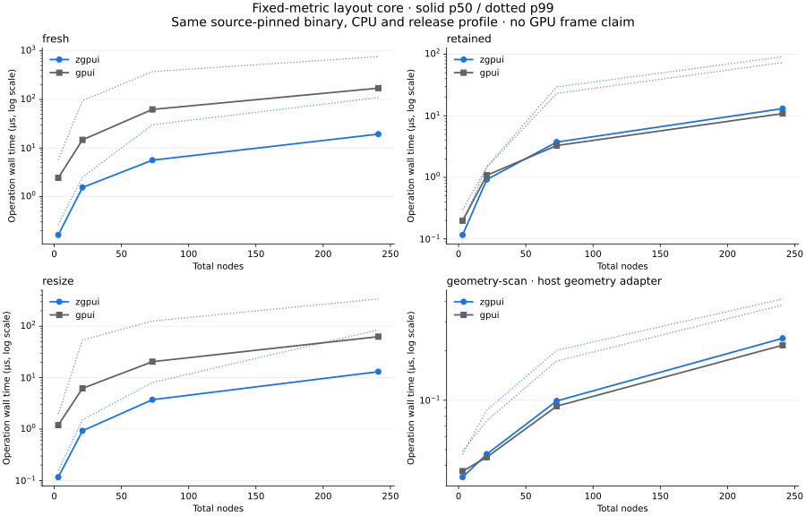

# Cloud CPU baseline — 20 November 2026

This first measured baseline does **not** establish that zgpui surpasses GPUI across all workloads. On the fixed geometry task, zgpui had lower paired mean times for fresh layout and resize. GPUI had lower paired mean times for larger retained layouts and some geometry scans. The [full tables](report.md), [counter quality](quality.json), and [source-bound provenance](provenance.json) retain the differences and limits.



The run used a managed Linux cloud CPU, not the user's native development machine. Both implementations were in the same timing executable, with CPU 0, nice 19, seed 20261120, seven paired process rounds and 5,000 individually timed operations per invocation. All 1,120,000 timing samples and 32,768 separate allocation-probe operations are retained. No tail was removed and no CPU or sample count was changed after observing a result.

The 69 zero scheduler-counter deltas do not mean zero CPU cost. Child RSS rose by process round, while every case's grouped median was 67,304 KiB; this does not isolate library memory from process/fork/collector effects. The whole selected-CPU interval recorded 13.80% steal ticks. The tables describe this observed environment, not a noise-free physical-machine result. Native startup, real event dispatch, text shaping and GPU frames remain unmeasured.

## Data and reproduction

The complete [raw archive](zgpui-gpui-cpu-raw-20261120.tar.gz) contains 519 original measurement files plus derived reports and execution receipts. Its SHA-256 is `400abff1703dd370a8479af47a4a696fe1c797437a5ac9fe38575c9849b2db53` (3,570,914 bytes). The archive inventory records every original file's SHA-256. The control receipts describe the actual cloud run; their absolute paths are historical observations, not portable setup instructions.

From `benchmarks/gpui-comparison`, regenerate the report without rerunning a benchmark:

```sh
mkdir -p .cache/published-baseline
tar -xzf reports/20261120-cloud-cpu/zgpui-gpui-cpu-raw-20261120.tar.gz -C .cache/published-baseline
python3 report.py .cache/published-baseline/raw
```

The [harness instructions](../../README.md) explain source preparation and a new build/run. Use an actually permitted CPU on the new host and record the new conditions. Reproduction on another machine is a new measurement, not an extension of this cloud sample.

[中文解读](FINDINGS.zh-CN.md) explains the measured strengths, gaps and next optimization boundary.
